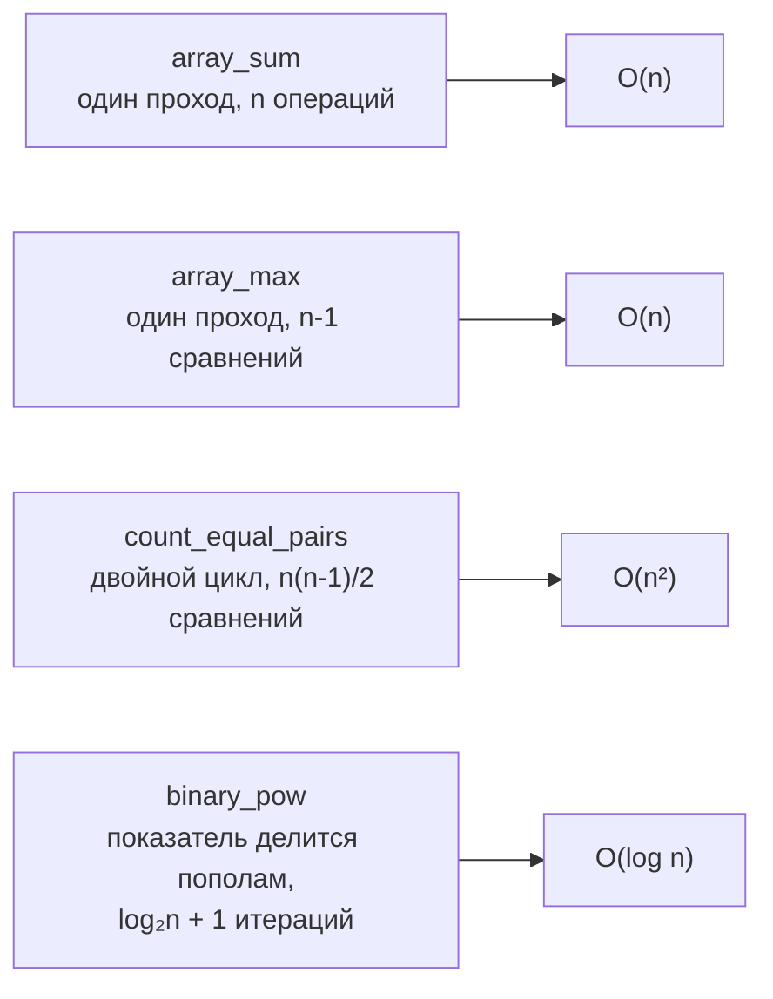

# Лабораторная работа № 1

**Анализ временной сложности элементарных алгоритмов (КИМ-01)**

Дисциплина: Структуры и алгоритмы обработки данных
Вариант: **29** (seed генератора данных = 30 + 29 = 59)

---

## 1. Условия эксперимента

| Параметр | Значение |
| --- | --- |
| Язык | Python 3 (CPython) |
| Данные | `data/generated`, вариант 29, seed 59 (сверено по `manifest.json`) |
| Размеры для линейных алгоритмов | 1 000; 3 000; 10 000; 30 000; 100 000 (тип `random`) |
| Размеры для квадратичного | 500; 1 000; 3 000; 10 000; 30 000 (тип `dups`) |
| Показатели для `binary_pow` | 10³; 10⁴; 10⁵; 10⁶; 10⁷ |
| Методика замера | прогревочный запуск (не учитывается), 5 повторов, медиана |
| Модуль для степени | 1 000 000 007, основание 3, 20 000 вызовов на точку |

Для `count_equal_pairs` использованы массивы типа `dups`: на случайных данных из широкого диапазона равных пар почти нет, ветка инкремента счётчика практически не исполняется и замер перестаёт быть репрезентативным. Размер 500 получен как префикс файла на 1 000 элементов; n = 100 000 для двойного цикла исключён по времени счёта.

## 2. Аналитический вывод сложности

### 2.1. `array_sum` — сумма элементов

Цикл выполняется ровно **n** раз, внутри одна операция сложения константного времени; плюс разовые накладные расходы на вызов функции и возврат:

```
T(n) = c₁·n + c₂  →  Θ(n),  верхняя оценка O(n)
```

Лучший, средний и худший случаи совпадают: число операций определяется только длиной массива и не зависит от значений элементов — сумму нельзя вычислить, не просмотрев все элементы.

Память: **O(1)** — одна переменная-накопитель независимо от размера входа.

*Инвариант цикла:* перед обработкой элемента с индексом i переменная `total` равна сумме `a[0..i-1]`; при i = n это сумма всего массива.

### 2.2. `array_max` — поиск максимума

Начальное значение — первый элемент массива, далее **n−1** сравнений:

```
T(n) = c₁·n + c₂  →  Θ(n),  верхняя оценка O(n)
```

Число сравнений от порядка данных не зависит, поэтому случаи совпадают. Различается лишь число присваиваний: 0 на невозрастающем массиве и n−1 на строго возрастающем — это влияет на константу, а не на порядок роста.

Память: **O(1)**.

*Инвариант цикла:* перед обработкой элемента i переменная `best` равна максимуму `a[0..i-1]`. Начальное значение берётся из массива (`a[0]`), а не константой: при старте с нуля на массиве из отрицательных чисел функция вернула бы значение, отсутствующее во входных данных.

### 2.3. `count_equal_pairs` — число пар равных элементов

Внешний цикл даёт n итераций; внутренний при индексе i выполняется (n − 1 − i) раз. Суммарное число сравнений:

```
S(n) = (n-1) + (n-2) + ... + 1 + 0 = n(n-1)/2 = n²/2 - n/2
```

Отбрасывая константный множитель и младший член:

```
T(n) = c₁·n²/2 + c₂·n + c₃  →  Θ(n²),  верхняя оценка O(n²)
```

Сравниваются все пары индексов независимо от содержимого массива, поэтому случаи совпадают; данные влияют только на число срабатываний инкремента счётчика (не более n(n−1)/2), что не меняет порядок роста.

Память: **O(1)**.

*Инвариант цикла:* перед началом итерации с индексом i переменная `count` равна числу равных пар, у которых первый индекс строго меньше i. Условие `j > i` обеспечивает, что элемент не сравнивается сам с собой и каждая пара учитывается ровно один раз.

### 2.4. `binary_pow` — бинарное возведение в степень

Алгоритм опирается на тождества:

```
x^n = (x^(n/2))²   при чётном n
x^n = x · x^(n-1)  при нечётном n
```

На каждой итерации показатель делится нацело на 2, поэтому число итераций равно числу двоичных разрядов показателя:

```
T(n) = c₁·(⌊log₂ n⌋ + 1) + c₂  →  Θ(log n),  верхняя оценка O(log n)
```

Худший случай (все биты показателя единичные, n = 2ᵏ − 1) требует двух умножений на итерацию вместо одного — отличие в константе, а не в порядке роста.

Память: **O(1)** — две переменные (`result`, `base`).

*Инвариант цикла:* величина `result · base^n` на каждом шаге равна исходному xⁿ (по модулю mod, если он задан). Начальное значение `result = 1` — нейтральный элемент умножения; при n = 0 цикл не выполняется и функция корректно возвращает 1.

### Сводка



## 3. Результаты замеров

### 3.1. Линейные алгоритмы (тип `random`)

| n | `array_sum`, с | `array_max`, с |
| --- | --- | --- |
| 1 000 | 0,000017 | 0,000022 |
| 3 000 | 0,000049 | 0,000045 |
| 10 000 | 0,000161 | 0,000148 |
| 30 000 | 0,000486 | 0,000474 |
| 100 000 | 0,001660 | 0,001473 |

### 3.2. Квадратичный алгоритм (тип `dups`)

| n | Время, с | Рост времени | Ожидаемый рост (n²) |
| --- | --- | --- | --- |
| 500 | 0,004051 | — | — |
| 1 000 | 0,015234 | ×3,76 | ×4,00 |
| 3 000 | 0,133998 | ×8,80 | ×9,00 |
| 10 000 | 1,413621 | ×10,55 | ×11,11 |
| 30 000 | 12,110921 | ×8,57 | ×9,00 |

### 3.3. Бинарное возведение в степень (по модулю 1 000 000 007)

| n | log₂ n | Время одного вызова, с |
| --- | --- | --- |
| 10³ | 10,0 | 0,000001005 |
| 10⁴ | 13,3 | 0,000001308 |
| 10⁵ | 16,6 | 0,000001645 |
| 10⁶ | 19,9 | 0,000001934 |
| 10⁷ | 23,3 | 0,000002379 |

Графики: `lab01_loglog.png` (степенные алгоритмы, оси log-log) и `lab01_binary_pow.png` (бинарная степень, ось абсцисс — log₂ n).

## 4. Сопоставление теории и эксперимента

### 4.1. Наклон в осях log-log

Для степенной зависимости t = C·nᵏ логарифмирование обеих частей даёт:

```
lg t = k · lg n + lg C
```

Это уравнение прямой с наклоном, равным показателю степени k. Константа C на наклон не влияет — она сдвигает прямую по вертикали. Измеренные наклоны (метод наименьших квадратов):

| Алгоритм | Теоретический показатель | Наблюдаемый наклон | Расхождение |
| --- | --- | --- | --- |
| `array_sum` | 1 | 0,992 | −0,8 % |
| `array_max` | 1 | 0,933 | −6,7 % |
| `count_equal_pairs` | 2 | 1,958 | −2,1 % |

Наклоны близки к теоретическим показателям: аналитические оценки O(n), O(n) и O(n²) подтверждены экспериментально. Наибольшее расхождение у `array_max` (−6,7 %) объясняется шумом на малых размерах входа — см. п. 4.2.

### 4.2. Объяснение расхождений

**Константы, скрытые в Big-O.** `array_sum` и `array_max` имеют одинаковую асимптотику, но различаются по абсолютному времени (на n = 100 000 — 1,66 мс против 1,47 мс): на типичной итерации максимум выполняет только сравнение, тогда как сумма — сложение целочисленных объектов Python. На графике это две прямые с одинаковым наклоном и разным вертикальным смещением.

**Шум на малых размерах входа.** Основной источник отклонения наклона `array_max` (0,933 вместо 1). При n = 1 000 время составляет 22 мкс — величина, сопоставимая с погрешностью таймера и фоновой активностью ОС, поэтому левая точка завышена. Завышенная левая точка уменьшает наклон прямой, хотя на правом участке (10 000 → 100 000) рост близок к линейному. Устранить это можно увеличением числа повторов или замером пакета вызовов, как сделано для `binary_pow`.

**Влияние накладных расходов на малых n.** Фактически T(n) = a·n² + b·n + c, и при n порядка 10³ младшие члены ещё не пренебрежимы: отсюда отклонения отношений времени от идеального квадрата на левом краю диапазона (×3,76 вместо ×4,00 при переходе 500 → 1 000).

**Иерархия памяти на больших n.** При переходе 3 000 → 10 000 время `count_equal_pairs` растёт в 10,55 раза при ожидаемых 11,11, а на участке 10 000 → 30 000 — в 8,57 вместо 9. Отклонения в обе стороны вызваны тем, что на больших массивах данные и указатели на объекты перестают помещаться в кэш процессора и средняя стоимость обращения к элементу перестаёт быть постоянной. Модель RAM, в которой выведена оценка O(n²), считает любое обращение к памяти константным по времени и этот эффект не учитывает.

**Шум измерений.** Накладные расходы интерпретатора CPython (боксинг целых, динамическая диспетчеризация), работа сборщика мусора и фоновые процессы ОС вносят случайную составляющую. Методика компенсирует это так: прогревочный запуск исключает эффекты первого обращения, а медиана по 5 повторам вместо среднего устойчива к редким выбросам от переключения контекста.

Существенно, что все перечисленные факторы влияют на **константы**, а не на порядок роста — поэтому измеренные наклоны остаются близки к теоретическим.

### 4.3. Почему для логарифмического алгоритма log-log неинформативен

В осях log-log зависимость t = C·log₂ n + D принимает вид lg t = lg(C·log₂ n + D) — это **не прямая**, а медленно растущая вогнутая кривая. Формально посчитанный по тем же точкам «наклон» равен **0,092**: он не соответствует ни константной сложности (наклон 0), ни линейной (наклон 1), и меняется в зависимости от выбранного диапазона n. Отличить по такому графику O(log n) от O(1) практически невозможно.

Поэтому для `binary_pow` выбраны линейные оси с абсциссой log₂ n: логарифмическая зависимость в них выпрямляется. Линейная регрессия t = k·log₂ n + b даёт:

```
k = 101,6 нс на один бит показателя
b = −32,8 нс (свободный член, в пределах погрешности аппроксимации)
R² = 0,9942
```

Коэффициент детерминации 0,994 подтверждает линейность по числу бит показателя, то есть логарифмическую зависимость от n. Коэффициент k имеет физический смысл стоимости одной итерации цикла (проверка бита, одно-два модульных умножения).

Наглядная иллюстрация: при росте показателя с 10³ до 10⁷ — в **десять тысяч раз** — время одного вызова увеличилось лишь с 1,01 до 2,38 мкс, то есть примерно вдвое.

### 4.4. Почему замер выполняется по модулю

Без модуля Python использует длинную арифметику — числа произвольной точности. Величина 3^(10⁷) содержит около 4,8 млн десятичных разрядов, и стоимость одного умножения таких чисел сама зависит от их длины. В результате замер отражал бы скорость умножения гигантских чисел, а не число итераций алгоритма, и наблюдаемый рост оказался бы полиномиальным вместо логарифмического.

Взятие остатка по модулю 1 000 000 007 после каждого умножения удерживает операнды в пределах машинного слова, поэтому стоимость итерации постоянна — и замер отражает именно число итераций, то есть log₂ n. Это соответствует модели RAM, в которой выведена оценка O(log n).

Дополнительно: одно возведение в степень выполняется за микросекунды, что сопоставимо с разрешением таймера, поэтому замеряется пакет из 20 000 вызовов с последующим делением на их число.

## 5. Верификация

Методика — `docs/ai-verification.md`, шаги 1–4.

### Шаг 1. Инварианты

Сформулированы в разделе 2 и проверены в `self_check()`:

- `count_equal_pairs` на массиве попарно различных элементов равен 0;
- на массиве из n одинаковых элементов результат равен C(n, 2) = n(n−1)/2;
- результат `count_equal_pairs` не зависит от порядка элементов;
- `array_max` возвращает значение, принадлежащее массиву и не меньшее любого его элемента;
- `binary_pow(x, 0) = 1`; согласованность режимов с модулем и без него.

### Шаг 2. Репрезентативные тесты

- **граничные:** пустой массив, массив из одного элемента, показатель степени n = 0;
- **вырожденные:** все элементы равны, попарно различные элементы;
- **типовые:** сотни случайных массивов разной длины, в том числе с отрицательными значениями и дубликатами.

### Шаг 3. Сравнение с эталоном

Результаты сверены со стандартными реализациями на сотнях случайных входов: `sum()` для `array_sum`, `max()` для `array_max`, трёхаргументный `pow(x, n, mod)` для `binary_pow`. Расхождений не обнаружено — `self_check` завершается успешно.

### Шаг 4. Оценка сложности

Выполнена в разделах 2 и 4. Аналитические оценки O(n), O(n), O(n²), O(log n) подтверждены измеренными наклонами 0,992 / 0,933 / 1,958 и линейной зависимостью t(log₂ n) с R² = 0,994. Асимптотически худших реализаций не выявлено.

### Вывод о применимости

**Принять.** Реализации корректны (инварианты выполняются, расхождений с эталонами нет на граничных, вырожденных и случайных входах) и соответствуют заявленной асимптотике по результатам профилирования. Наблюдаемые отклонения от идеальных зависимостей объясняются известными ограничениями модели RAM и не свидетельствуют о дефектах алгоритмов.

## 6. Выводы

1. Оценки O(n) для суммы и максимума, O(n²) для подсчёта равных пар и O(log n) для бинарного возведения в степень выведены аналитически и подтверждены экспериментально на данных варианта 29.
2. Измеренные наклоны в осях log-log (0,992; 0,933; 1,958) соответствуют теоретическим показателям степени; наибольшее отклонение (`array_max`, 0,933) вызвано шумом измерения на малых размерах входа, а не иной асимптотикой.
3. Big-O описывает порядок роста, но не константы: при одинаковой сложности O(n) абсолютное время `array_sum` и `array_max` различается на десятки процентов.
4. Отклонения реальных замеров от идеальной модели возникают на краях диапазона: на малых n — из-за фиксированных накладных расходов, на больших — из-за промахов кэша. Модель RAM этих эффектов не учитывает.
5. Выбор осей графика определяется типом зависимости: для степенных — log-log, где наклон равен показателю степени; для логарифмических — линейные оси по log₂ n.
6. Условия замера должны соответствовать модели, в которой выведена оценка: длинная арифметика Python нарушает предположение о константной стоимости операции, поэтому возведение в степень замеряется по модулю.
