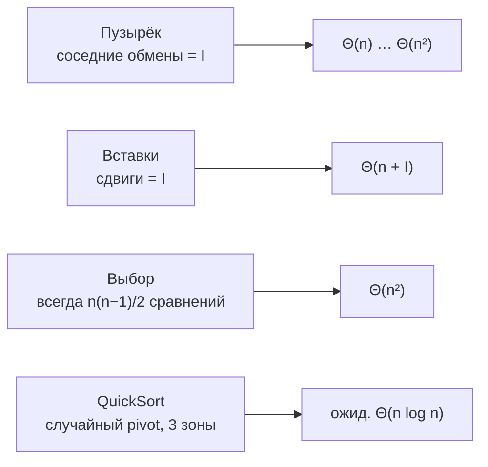

# Лабораторная работа № 3

**Простые сортировки и QuickSort с рандомизацией (КИМ-03)**

Дисциплина: Структуры и алгоритмы обработки данных
Вариант: **29** (seed = 30 + 29 = 59)

---

## 1. Условия эксперимента

| Параметр | Значение |
| --- | --- |
| Язык | Python 3 (CPython) |
| Данные | целые числа из [−1 000 000; 1 000 000], генератор `random.Random(59 + n)` |
| Классы входа | упорядоченный, случайный, обратный (одни и те же числа в трёх порядках) |
| Размеры для простых сортировок | 500; 1 000; 2 000; 4 000; 8 000 |
| Размеры для QuickSort | 1 000; 3 000; 10 000; 30 000; 100 000 |
| Методика замера | прогревочный запуск (не учитывается), 5 повторов, медиана; каждому запуску — свежая копия входа |
| Генератор опорного элемента QuickSort | `random.Random(59)` — результат воспроизводим |

Простые сортировки замеряются на меньших размерах: при n = 100 000 квадратичный алгоритм выполнил бы около 5·10⁹ сравнений, что в CPython заняло бы часы.

Копия входа перед каждым запуском обязательна: иначе после первого прогона массив уже отсортирован, и все следующие повторы на «случайном» и «обратном» входе фактически замеряли бы лучший случай.

## 2. Теория и аналитический вывод сложности

### 2.0. Основные понятия

**Инверсия** — пара индексов i < j, у которой a[i] > a[j], то есть пара элементов, стоящих «не в том порядке». В упорядоченном массиве инверсий 0, в обратном — максимум n(n−1)/2, в случайном в среднем вдвое меньше максимума: n(n−1)/4 (каждая из пар с равной вероятностью стоит правильно или неправильно).

Число инверсий I — мера «неотсортированности». Любая сортировка, которая за один шаг меняет местами только **соседние** элементы, устраняет ровно одну инверсию за шаг, поэтому ей нужно ровно I обменов — а в среднем это Θ(n²).

**Устойчивость (стабильность).** Сортировка устойчива, если элементы с равными ключами сохраняют исходный взаимный порядок. Это важно при сортировке записей по одному полю после сортировки по другому: например, список студентов, отсортированный по фамилии, после устойчивой сортировки по группе остаётся упорядоченным по фамилии внутри каждой группы.

**Сортировка на месте (in-place)** — использует O(1) дополнительной памяти сверх самого массива.

**Адаптивность** — алгоритм работает быстрее на «почти отсортированных» входах.

### 2.1. Сортировка пузырьком (`bubble_sort`)

На проходе i соседние элементы сравниваются слева направо, и больший «всплывает» в конец; после прохода i последние i+1 элементов стоят на своих местах, поэтому внутренний цикл укорачивается: n−1−i сравнений.

*Инвариант:* после k проходов последние k элементов массива — k наибольших, в отсортированном порядке.

**Досрочный выход:** если за проход не было ни одного обмена, массив уже отсортирован и дальнейшие проходы не нужны.

| Случай | Сравнения | Обмены | Время |
| --- | --- | --- | --- |
| Лучший (упорядоченный) | n − 1 (один проход, выход) | 0 | Θ(n) |
| Худший (обратный) | n(n−1)/2 | n(n−1)/2 | Θ(n²) |
| Средний (случайный) | ≈ n²/2 | I ≈ n²/4 | Θ(n²) |

Обмены всегда равны числу инверсий: каждый обмен соседей a[j] > a[j+1] устраняет ровно одну инверсию и не создаёт новых.

Память **O(1)**. **Устойчива:** обмен выполняется только при строгом `a[j] > a[j+1]`, равные элементы никогда не меняются местами.

### 2.2. Сортировка вставками (`insertion_sort`)

Массив делится на отсортированную левую часть и неотсортированную правую. Очередной элемент «вынимается» и сдвигается влево, пока слева стоит больший; затем вставляется в освободившуюся позицию. Используются **сдвиги** (одно присваивание), а не обмены (три присваивания).

*Инвариант:* перед итерацией i префикс a[0..i−1] отсортирован и является перестановкой исходного префикса.

| Случай | Сравнения | Сдвиги | Время |
| --- | --- | --- | --- |
| Лучший (упорядоченный) | n − 1 | 0 | Θ(n) |
| Худший (обратный) | n(n−1)/2 | n(n−1)/2 | Θ(n²) |
| Средний (случайный) | ≈ n²/4 | I ≈ n²/4 | Θ(n²) |

В общем виде время Θ(n + I): каждый сдвиг устраняет одну инверсию, а сравнений не больше, чем сдвигов плюс одно на элемент. Поэтому вставки — **адаптивный** алгоритм и практический выбор для почти отсортированных и маленьких массивов (на этом основаны гибридные сортировки, например Timsort в самом Python).

На случайном входе вставки выполняют примерно **вдвое меньше сравнений**, чем пузырёк: внутренний цикл останавливается, как только найдено место элемента, — в среднем на середине отсортированной части.

Память **O(1)**. **Устойчива:** сдвиг только при строгом `a[j] > current`, поэтому элемент не обгоняет равный ему.

### 2.3. Сортировка выбором (`selection_sort`)

На шаге i в неотсортированной части a[i..n−1] ищется минимум и меняется местами с a[i].

*Инвариант:* после шага i префикс a[0..i] содержит i+1 наименьших элементов в отсортированном порядке.

| Случай | Сравнения | Обмены | Время |
| --- | --- | --- | --- |
| Любой | ровно n(n−1)/2 | ≤ n − 1 | Θ(n²) |

Поиск минимума всегда просматривает весь неотсортированный остаток, поэтому число сравнений от входа не зависит — алгоритм **неадаптивный**: на упорядоченном массиве он так же медленен, как на случайном. Зато обменов не больше n − 1 — минимум среди простых сортировок; это полезно, когда запись элемента дорога (например, во флеш-память).

Память **O(1)**. **Неустойчива:** обмен «дальний» — a[i] может перепрыгнуть через равные себе элементы. Пример из `stability_demo`:

```
вход:     (2,a) (1,b) (2,c) (1,d)
i = 0:    минимум (1,b) на позиции 1 → обмен с (2,a)  →  (1,b) (2,a) (2,c) (1,d)
i = 1:    минимум (1,d) на позиции 3 → обмен с (2,a)  →  (1,b) (1,d) (2,c) (2,a)
итог:     метки ключа 2 — [c, a], а во входе были [a, c]  →  порядок нарушен
```

### 2.4. QuickSort с рандомизацией и трёхпутевым разбиением (`quick_sort`)

**Идея «разделяй и властвуй».** Выбирается опорный элемент p (pivot); массив переставляется так, чтобы слева оказались элементы меньше p, справа — больше; затем обе части сортируются тем же способом. Отсортированные части уже стоят на своих местах — объединять ничего не нужно.

**Трёхпутевое разбиение (схема Дейкстры, «голландский флаг»).** Отрезок делится на три зоны:

```
[lo .. lt)   < p
[lt .. i)    = p
[i  .. gt)   ещё не просмотрены
[gt .. hi)   > p
```

Указатель i идёт слева направо: меньший элемент обменивается в левую зону, больший — в правую (i при этом не сдвигается, потому что пришедший с правого края элемент ещё не просмотрен), равный остаётся на месте. После разбиения средняя зона **окончательно** на месте, и рекурсия идёт только по зонам «< p» и «> p». Классическое двухпутевое разбиение на массиве из одинаковых элементов вырождается в Θ(n²); трёхпутевое обрабатывает его за **Θ(n)** — один проход, и обе боковые зоны пусты.

**Рандомизация опорного.** Если брать первый элемент, то на упорядоченном и обратном входах каждое разбиение отщепляет один элемент: глубина n, время n + (n−1) + … = Θ(n²). При случайном выборе опорного **ни один конкретный вход не является плохим**: плохим может быть только неудачное стечение случайных выборов, вероятность которого исчезающе мала. Ожидаемая сложность — Θ(n log n) на **любом** входе.

**Ожидаемое число сравнений.** Элементы с рангами i < j сравниваются тогда и только тогда, когда первым опорным среди рангов i..j выбран i или j; вероятность этого 2/(j − i + 1). Суммируя по всем парам:

```
E[C(n)] = Σ 2/(j−i+1) ≈ 2n·ln n ≈ 1,39·n·log₂ n
```

То есть случайный QuickSort в среднем лишь на 39 % хуже теоретического предела log₂(n!) ≈ n·log₂ n для сортировок сравнениями.

**Итеративность и глубина стека.** Вместо рекурсии используется явный стек отрезков. После разбиения в стек сначала кладётся **больший** отрезок, затем меньший — он снимается первым. Так каждый отложенный отрезок как минимум вдвое больше обрабатываемого, и в стеке одновременно не больше log₂ n отрезков: дополнительная память **O(log n)** даже в худшем случае. Рекурсивная версия в CPython упиралась бы в лимит глубины рекурсии (1000) при неудачных разбиениях; проверка `check_quick_deterministic` сортирует обратный массив из 20 000 элементов.

| Случай | Время | Доп. память |
| --- | --- | --- |
| Ожидаемый (любой вход) | Θ(n log n) | O(log n) |
| Худший (крайне маловероятен) | Θ(n²) | O(log n) |
| Все элементы равны | Θ(n) | O(1) |

**Неустойчива:** обмены через всю длину отрезка переставляют равные элементы.

Функция возвращает новый список (`a = list(a)`), входной не меняется — это ещё O(n) памяти на копию, но это требование интерфейса, а не свойство алгоритма.

### 2.5. Сводка

| Алгоритм | Лучший | Средний | Худший | Память | Устойчив | Адаптивен |
| --- | --- | --- | --- | --- | --- | --- |
| Пузырёк (с выходом) | Θ(n) | Θ(n²) | Θ(n²) | O(1) | да | да |
| Вставки | Θ(n) | Θ(n²) | Θ(n²) | O(1) | да | да, Θ(n + I) |
| Выбор | Θ(n²) | Θ(n²) | Θ(n²) | O(1) | нет | нет |
| QuickSort (случ., 3-путевой) | Θ(n)* | Θ(n log n) | Θ(n²)** | O(log n) | нет | нет |

\* — только когда все ключи равны; \*\* — с исчезающе малой вероятностью.



## 3. Результаты замеров

Полный вывод программы — `lab03_output.txt`, графики — `lab03_loglog.png` (все алгоритмы, log-log, с опорными линиями O(n²) и O(n log n)) и `lab03_simple.png` (только простые сортировки).

### 3.1. Простые сортировки, время (медиана, с)

| n | Пузырёк упоряд. | Пузырёк случ. | Пузырёк обр. | Вставки упоряд. | Вставки случ. | Вставки обр. | Выбор упоряд. | Выбор случ. | Выбор обр. |
| --- | --- | --- | --- | --- | --- | --- | --- | --- | --- |
| 500 | 0,000023 | 0,009136 | 0,011841 | 0,000037 | 0,004725 | 0,009905 | 0,004538 | 0,005166 | 0,005034 |
| 1 000 | 0,000045 | 0,038345 | 0,050760 | 0,000078 | 0,019498 | 0,040550 | 0,018572 | 0,019616 | 0,020637 |
| 2 000 | 0,000092 | 0,162092 | 0,209353 | 0,000167 | 0,078596 | 0,162298 | 0,076651 | 0,076887 | 0,083893 |
| 4 000 | 0,000198 | 0,656117 | 0,842268 | 0,000332 | 0,328194 | 0,649255 | 0,307795 | 0,318086 | 0,329889 |
| 8 000 | 0,000402 | 2,618517 | 3,390929 | 0,000673 | 1,312794 | 2,610373 | 1,237692 | 1,250916 | 1,322830 |

Рост времени при удвоении n на случайном входе (для Θ(n²) ожидается ×4):

| Переход | Пузырёк | Вставки | Выбор |
| --- | --- | --- | --- |
| 500 → 1 000 | ×4,20 | ×4,13 | ×3,80 |
| 1 000 → 2 000 | ×4,23 | ×4,03 | ×3,92 |
| 2 000 → 4 000 | ×4,05 | ×4,18 | ×4,14 |
| 4 000 → 8 000 | ×3,99 | ×4,00 | ×3,93 |

### 3.2. QuickSort, время (медиана, с)

| n | Упорядоченный | Случайный | Обратный | t / (n·log₂ n), нс (случ.) |
| --- | --- | --- | --- | --- |
| 1 000 | 0,001088 | 0,001122 | 0,001103 | 112,6 |
| 3 000 | 0,003796 | 0,003969 | 0,003728 | 114,5 |
| 10 000 | 0,014786 | 0,015870 | 0,015049 | 119,4 |
| 30 000 | 0,049788 | 0,052643 | 0,050297 | 118,0 |
| 100 000 | 0,188799 | 0,194368 | 0,197662 | 117,0 |

### 3.3. Счётчики простых сортировок (n = 8 000)

| Алгоритм | Вход | Сравнения | Обмены / сдвиги | Теория |
| --- | --- | --- | --- | --- |
| Пузырёк | упорядоченный | 7 999 | 0 | n − 1; 0 |
| Пузырёк | случайный | 31 992 514 | 15 930 332 | ≤ n(n−1)/2; = I |
| Пузырёк | обратный | 31 996 000 | 31 995 980 | n(n−1)/2; = I |
| Вставки | упорядоченный | 7 999 | 0 | n − 1; 0 |
| Вставки | случайный | 15 938 320 | 15 930 332 | ≈ I + n; = I |
| Вставки | обратный | 31 996 000 | 31 995 980 | n(n−1)/2; = I |
| Выбор | упорядоченный | 31 996 000 | 0 | n(n−1)/2; 0 |
| Выбор | случайный | 31 996 000 | 7 989 | n(n−1)/2; ≈ n − Hₙ = 7 990 |
| Выбор | обратный | 31 996 000 | 4 015 | n(n−1)/2; ≈ n/2 |

n(n−1)/2 при n = 8 000 равно 31 996 000. Полная таблица для всех n — в `lab03_output.txt`.

### 3.4. Устойчивость (`stability_demo`)

| Алгоритм | Метки ключа 1 | Метки ключа 2 | Вывод |
| --- | --- | --- | --- |
| исходный порядок | b, d | a, c | — |
| Пузырёк | b, d | a, c | устойчива |
| Вставки | b, d | a, c | устойчива |
| Выбор | b, d | **c, a** | неустойчива |
| QuickSort | **d, b** | **c, a** | неустойчива |

## 4. Сопоставление теории и эксперимента

### 4.1. Наклоны в осях log-log

Для t = C·nᵏ имеем lg t = k·lg n + lg C — прямая с наклоном k. Измеренные наклоны (МНК):

| Алгоритм | Упорядоченный | Случайный | Обратный | Теория |
| --- | --- | --- | --- | --- |
| Пузырёк | **1,04** | 2,04 | 2,04 | 1 / 2 / 2 |
| Вставки | **1,04** | 2,03 | 2,01 | 1 / 2 / 2 |
| Выбор | **2,02** | 1,99 | 2,01 | 2 / 2 / 2 |
| QuickSort | 1,12 | 1,12 | 1,13 | ≈ 1,11 (см. 4.4) |

Все наклоны в пределах ±0,04 от теоретических показателей. Главное наблюдение — **левый столбец**: на упорядоченном входе пузырёк и вставки линейны (наклон ≈ 1), а выбор остаётся квадратичным (≈ 2). Это прямое экспериментальное подтверждение адаптивности первых двух и неадаптивности третьего.

### 4.2. Счётчики совпадают с формулами — и объясняют мелкие расхождения

**Почему на обратном входе обменов на 20 меньше, чем n(n−1)/2.** Обмены пузырька и сдвиги вставок равны числу инверсий I. В обратном массиве без повторов I = n(n−1)/2, но в данных варианта есть **совпадающие числа**: пара равных элементов не является инверсией. Подсчёт пар равных значений во входных массивах даёт 0; 2; 1; 3; 20 для n = 500 … 8 000 — и ровно на столько же обменов меньше в таблице (499 500 − 499 498 = 2 при n = 1 000; 31 996 000 − 31 995 980 = 20 при n = 8 000). Совпадение точное, это не погрешность, а свойство данных.

**Пузырёк и вставки делают одинаковое число перестановок** на любом входе (15 930 332 на случайном) — оба равны числу инверсий, хотя алгоритмы разные.

**Вставки на случайном входе — вдвое меньше сравнений, чем пузырёк** (15,9 млн против 32,0 млн): число сравнений ≈ I + n, а I ≈ n²/4. Сравнений на 7 988 больше, чем сдвигов: на каждом из n − 1 шагов цикл заканчивается одним «неудачным» сравнением, кроме случаев, когда элемент — новый минимум префикса и цикл выходит по `j < 0` (таких ≈ ln n).

**Пузырёк на случайном входе** сравнивает чуть меньше n(n−1)/2 (31 992 514): досрочный выход срабатывает за несколько проходов до конца — последние элементы встают на место раньше.

**Выбор: обмены.** На упорядоченном входе 0 (минимум уже на месте, условие `smallest != i` отсекает обмен). На обратном — около n/2: обмен a[i] ↔ a[n−1−i] ставит на место сразу **два** элемента. На случайном — 7 989 при теоретическом ожидании n − Hₙ = 7 990 (Hₙ ≈ ln n + 0,577 — гармоническое число; обмен не нужен, если минимум уже стоит на позиции i, что в среднем происходит Hₙ раз).

### 4.3. Почему при одинаковом Θ(n²) время различается

На случайном входе при n = 8 000: пузырёк 2,62 с, вставки 1,31 с, выбор 1,25 с.

- **Вставки вдвое быстрее пузырька** — ровно во столько же раз меньше сравнений (≈ n²/4 против ≈ n²/2), а сдвиг (одно присваивание) дешевле обмена (кортежное присваивание двух элементов).
- **Выбор так же быстр, как вставки, хотя сравнений у него вдвое больше.** Внутренний цикл выбора — только сравнение и изредка запись индекса; у вставок на каждой итерации сравнение плюс сдвиг элемента в списке. В CPython стоимость операции над элементом списка заметно выше стоимости сравнения целых, и это уравнивает счёт.
- **Обратный вход у пузырька и вставок медленнее случайного** (3,39 и 2,61 с): перестановок вдвое больше (I = n²/2 вместо n²/4), а у вставок вдвое больше и сравнений.

Это иллюстрация того, что Big-O описывает порядок роста, а не время: константы зависят от того, **какие** операции выполняются и сколько стоит каждая.

### 4.4. QuickSort: наклон 1,12 — это и есть n log n

Функция n·log n — не степенная, поэтому в осях log-log она не строго прямая. Её локальный наклон:

```
d ln(n·ln n) / d ln n = 1 + 1/ln n
```

В диапазоне n = 10³ … 10⁵ это 1,145 … 1,087, в середине диапазона (n = 10⁴) — **1,109**. Измерено **1,12–1,13**: совпадение с n log n, а не с n¹ или n².

Более надёжная проверка — нормировка: t / (n·log₂ n) должна быть постоянной. По таблице 3.2 она держится в пределах **113–119 нс** при росте n в 100 раз. Небольшой рост к большим n объясняется кэшем: массив из 100 000 объектов-целых Python занимает несколько мегабайт и перестаёт помещаться в быстрые уровни кэша процессора.

### 4.5. QuickSort: рандомизация убирает зависимость от входа

Время на упорядоченном, случайном и обратном входах различается не больше чем на 5 % на всех n (например, 0,189 / 0,194 / 0,198 с при n = 100 000). Для QuickSort с опорным «первый элемент» упорядоченный и обратный вход — худший случай Θ(n²): при n = 100 000 это было бы ~5·10⁹ операций и переполнение стека рекурсии. Случайный выбор опорного делает все входы одинаково «средними».

### 4.6. Простые сортировки против QuickSort

При n = 8 000 на случайном входе QuickSort (≈ 0,012 с по интерполяции таблицы 3.2) примерно в **100 раз** быстрее вставок (1,31 с), а разрыв растёт как n / log n. Простые сортировки выигрывают только на очень маленьких или почти отсортированных массивах: у вставок на упорядоченном входе при n = 8 000 — 0,7 мс, быстрее QuickSort.

## 5. Верификация

### Шаг 1. Инварианты

Сформулированы в разделе 2 и проверены в `self_check()`:

- результат отсортирован и является перестановкой входа;
- **входной список не изменяется** (`check_input_untouched`) — иначе повторы замера шли бы на уже отсортированных данных;
- точные значения счётчиков: пузырёк и вставки на упорядоченном — (n − 1, 0), на обратном — (n(n−1)/2, n(n−1)/2); выбор — всегда n(n−1)/2 сравнений и не больше n − 1 обменов;
- **обмены пузырька = сдвиги вставок = число инверсий** на 50 случайных массивах с повторами (инверсии подсчитаны отдельно двойным циклом);
- устойчивость: пузырёк и вставки сохраняют порядок равных, выбор на демонстрационном входе — нет.

### Шаг 2. Репрезентативные тесты

- **граничные:** пустой список, один элемент;
- **вырожденные:** все элементы равны, уже упорядоченный, обратный;
- **типовые:** 300 случайных массивов длиной до 80 со значениями из узкого диапазона (много повторов);
- **нагрузочный:** QuickSort на обратном массиве из 20 000 элементов (проверка, что итеративная версия не упирается в глубину стека).

### Шаг 3. Сравнение с эталоном

Все четыре реализации сверены со встроенной `sorted()` на 300 случайных массивах; QuickSort с одинаковым seed даёт одинаковый результат. Расхождений нет — `self_check: OK`.

### Шаг 4. Оценка сложности

Аналитические оценки раздела 2 подтверждены наклонами log-log (раздел 4.1), точными значениями счётчиков (4.2) и постоянством t / (n·log₂ n) для QuickSort (4.4).

### Вывод о применимости

**Принять.** Реализации корректны и соответствуют заявленной асимптотике; все отклонения от идеальных формул объяснены (повторы во входных данных, константы операций CPython, кэш процессора) и не указывают на дефекты.

## 6. Выводы

1. Пузырёк, вставки и выбор имеют квадратичную сложность в среднем и худшем случаях — подтверждено наклонами 1,99–2,04 и ростом времени ≈ ×4 при удвоении n.
2. Пузырёк с досрочным выходом и вставки **адаптивны**: на упорядоченном входе наклон 1,04, то есть Θ(n). Выбор неадаптивен: наклон 2,02 даже на отсортированных данных, ровно n(n−1)/2 сравнений на любом входе.
3. Число перестановок у пузырька и вставок равно числу инверсий — это подтверждено точным совпадением, вплоть до учёта повторяющихся значений во входных данных.
4. При одинаковом Θ(n²) вставки вдвое быстрее пузырька: вдвое меньше сравнений и сдвиги вместо обменов. Выбор делает меньше всего обменов (≤ n − 1).
5. Пузырёк и вставки устойчивы, выбор и QuickSort — нет.
6. Рандомизированный QuickSort с трёхпутевым разбиением показал Θ(n log n): наклон 1,12 при теоретическом 1 + 1/ln n ≈ 1,11, t / (n log₂ n) ≈ 113–119 нс. Время не зависит от порядка входа — рандомизация устраняет худшие случаи.
7. Итеративная реализация с обработкой меньшей части первой ограничивает стек O(log n) и снимает ограничение CPython на глубину рекурсии.
